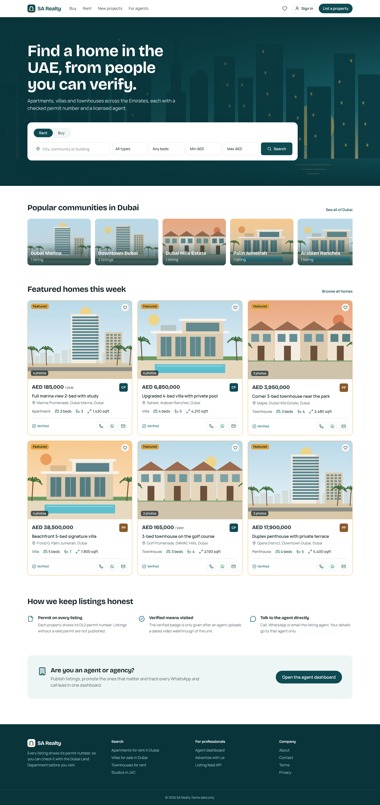
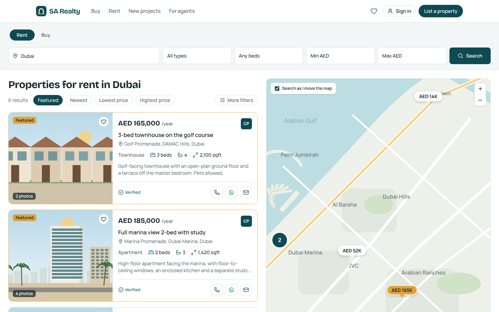
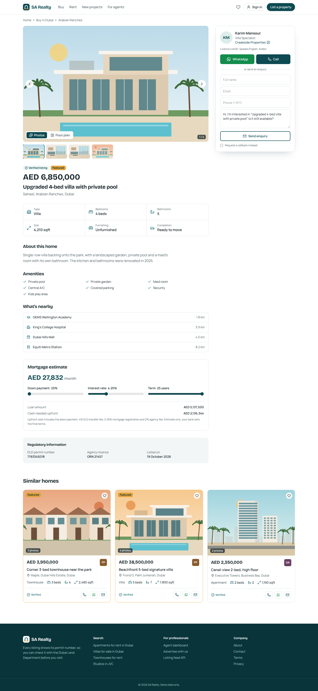
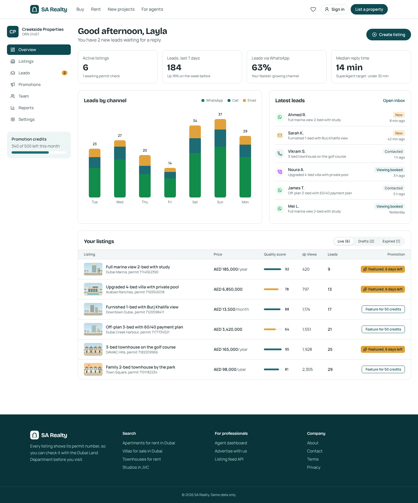

# SA Realty

A property portal for buying and renting homes in the UAE, in the spirit of Property Finder and Bayut.
This repository is the starter: a working Next.js front end with demo data, plus the production
database schema it will run on.

## What's in here

| Page | Route | Highlights |
| --- | --- | --- |
| Home | `/` | Rent/Buy search with location autocomplete, popular communities, featured homes |
| Search | `/search?purpose=rent&location=Dubai` | URL-driven filters, sorting, list + map split view with price pins and clustering |
| Property details | `/property/[slug]` | Photo gallery and floor plan, sticky agent card (WhatsApp, Call, Enquire), mortgage estimator with UAE fees, nearby places, DLD permit block, JSON-LD and OG image |
| Agent dashboard | `/dashboard` | Lead stats by channel, latest leads, listings table with quality score and "Feature" promotion |
| Lead API | `POST /api/leads`, `GET /api/leads/whatsapp?listing=` | Enquiry intake and WhatsApp click tracking before redirecting to wa.me |

## Tech stack

- **Next.js 16** (App Router, Server Components, Cache Components / Partial Prerendering)
- **Tailwind CSS 4**, **lucide-react** icons, self-hosted fonts (Bricolage Grotesque, Manrope)
- **PostgreSQL + PostGIS** with **Prisma** (`prisma/schema.prisma`, `prisma/sql/postgis.sql`)
- Planned: **Supabase** (Auth + Storage), **Typesense** (search + geo), **MapLibre GL** (maps)

## Getting started

```bash
npm install
cp .env.example .env.local
npm run dev
```

Open http://localhost:3000.

The app runs fully on demo data in `src/lib/mock-data.ts`; no database is needed yet.
Listing images are illustrated placeholders generated by `scripts/generate-placeholder-images.py`.

## Project structure

```
prisma/
  schema.prisma        Full data model: users & roles, agencies, agents, locations tree,
                       properties, media, amenities, leads, favorites, saved searches, promotions
  sql/postgis.sql      PostGIS extension, geo trigger and GiST indexes
src/
  app/
    page.tsx                         Home
    search/page.tsx                  Search results + map
    property/[slug]/page.tsx         Property details (JSON-LD, metadata)
    property/[slug]/opengraph-image  Social share card
    dashboard/page.tsx               Agent / agency dashboard
    api/leads/                       Lead intake + WhatsApp tracking
  components/                        Search bar, listing card, map, gallery, mortgage calculator, lead widget
  lib/
    types.ts, mock-data.ts, search.ts
```

## Roadmap

1. Connect Supabase: auth with roles (Buyer/Tenant, Agent, Agency Admin, System Admin) and row-level security
2. Run Prisma migrations and seed from `mock-data.ts`
3. Index properties into Typesense and replace `searchProperties()` with Typesense queries
4. Replace the offline map with MapLibre GL + Supercluster and "search as I move the map"
5. Listing create/edit flow with S3 / Supabase Storage uploads and image variants
6. Arabic (RTL) locale, saved searches with email alerts, favourites
7. Programmatic SEO landing pages and split sitemaps

## Scripts

| Command | What it does |
| --- | --- |
| `npm run dev` | Start the dev server |
| `npm run build` | Production build |
| `npm run start` | Serve the production build |
| `npm run lint` | Lint |

## Screenshots

| Home | Search with map |
| --- | --- |
|  |  |
| **Property details** | **Agent dashboard** |
|  |  |
