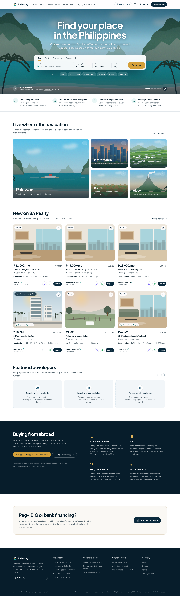
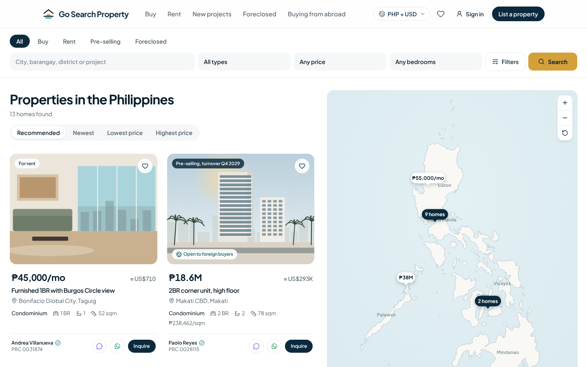
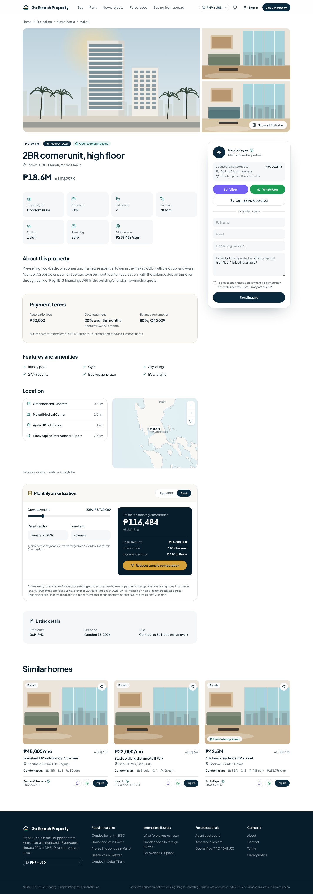
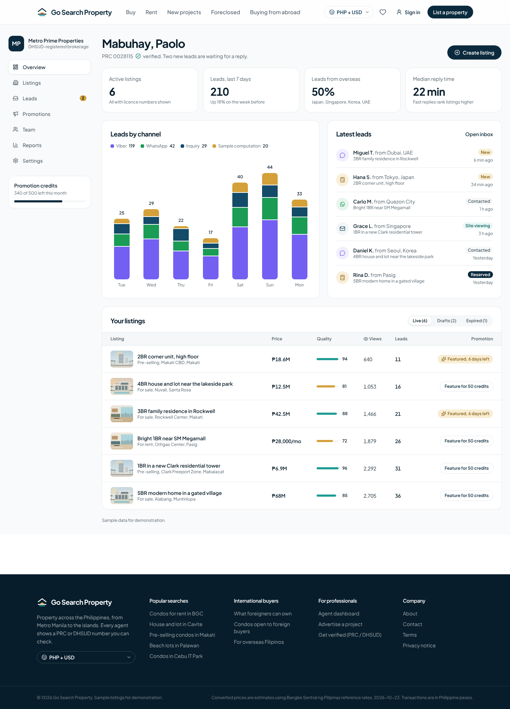
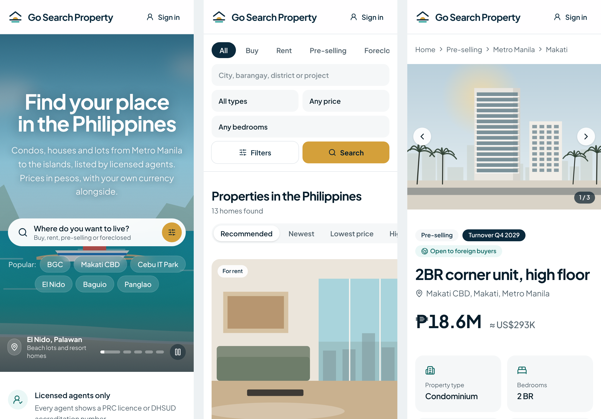

# Go Search Property — Philippine Real Estate Portal

A property marketplace for buying, renting, pre-selling and foreclosed homes across the Philippines, in the spirit of Lamudi, Dot Property and Property Finder. Built with Next.js, Tailwind CSS and PostgreSQL/PostGIS.



*Homepage layout. This screenshot was taken offline, so the hero shows the illustrated fallback; with an internet connection it shows the photographs.*

## Features

**Homepage**
- Rotating hero of professional photographs (El Nido, BGC, Batad rice terraces, Mayon Volcano, Chocolate Hills)
- Search panel with Buy / Rent / Pre-selling / Foreclosed, location suggestions from the location tree (understands aliases such as "BGC"), and a compact version on phones
- Destination cards, featured developer slots (empty until partnerships are signed), latest listings, "Buying from abroad" and a financing section

**Search** (`/search`)
- Shareable URL filters: transaction type, location (a province or city includes everything inside it), property type, price, bedrooms, condos open to foreign buyers, sort
- "More filters" drawer, empty state, loading skeleton
- Interactive Philippines map (Natural Earth outline) with clustered peso pins, zoom-on-cluster and a preview card; full-screen map on phones

**Property page** (`/property/[slug]`)
- Photo mosaic and full-screen viewer, key facts in sqm and ₱/sqm, pre-selling payment terms or foreclosure details, amenities, nearby places and a map
- Pag-IBIG and bank amortization calculator with published rates by fixing period, the ₱6M Pag-IBIG cap, and sources and dates
- Sticky agent card with PRC/DHSUD licence, Viber, WhatsApp, call, and an inquiry form with Data Privacy Act consent; "Request sample computation" fills the form from the calculator
- Schema.org `RealEstateListing` data and social preview images

**Agent dashboard** (`/dashboard`): leads by channel (Viber, WhatsApp, inquiry, sample computation), latest leads including overseas buyers, listings with quality score and promotion

**Calculator** (`/calculator`): standalone Pag-IBIG vs bank comparison

**International buyers**: prices in pesos with an estimate in 12 currencies (Bangko Sentral ng Pilipinas reference rates, dated), foreign-buyer badges and a sourced explainer of ownership rules

**Lead routes**: `GET /api/ph/leads/viber` and `/whatsapp` record the lead (ignoring crawlers and repeat taps) and open the chat (WhatsApp with a pre-filled message); `POST /api/ph/leads` accepts JSON only, validates every field, rate-limits by hashed IP, drops bot submissions and logs events without personal data. Inquiries are saved to the `Lead` table before the buyer sees "sent"; with no database a production server answers 503 rather than losing them. `GET /api/health` is the uptime check and pings the database.

**Security and privacy**: Content-Security-Policy, HSTS and other security headers on every page; the agent dashboard is locked with `DASHBOARD_USER` / `DASHBOARD_PASSWORD`; rate limits are shared across servers through Postgres; `erase_user()` and `purge_old_leads()` handle Data Privacy Act erasure requests and the 24-month retention period; a draft privacy notice is at `/privacy` (fill in the highlighted details and have it reviewed). Set `LEAD_IP_SALT`, `DASHBOARD_USER`, `DASHBOARD_PASSWORD` and `NEXT_PUBLIC_SITE_URL` in production

**Data model** (`prisma/schema.prisma`, 20 models), see [docs/data-model.md](docs/data-model.md): locations from Region to Barangay, properties in PHP and sqm for sale, rent, pre-selling and foreclosure, developers and projects with DHSUD License to Sell, RESA-licensed agents, hero banners, leads, saved searches and financing programs, with database CHECK rules and PostGIS triggers

## Screens

| Search with map | Property page |
| --- | --- |
|  |  |
| **Agent dashboard** | **Mobile** |
|  |  |

## Tech stack

- **Next.js 16** (App Router, Server Components, Cache Components) and TypeScript
- **Tailwind CSS 4**, lucide-react icons, Motion for animation, self-hosted fonts
- **PostgreSQL + PostGIS** with **Prisma 6**
- Planned: Supabase (auth and storage), Typesense (search), MapLibre (maps)

## Getting started

Requires Node.js 20 or later.

```bash
npm install
cp .env.example .env.local
npm run dev
```

Open http://localhost:3000. The homepage runs on sample data, so no database is needed to try it.

### Database (Supabase)

The production database is the Supabase project `uyfiidwrmytdugzcjjzo` (organization "Go Search Property"). It already has the full schema, the listing rules, the audit log, the privacy functions, the daily retention job and the reference data (82 locations, 21 amenities, 5 hero backgrounds). Browser keys have no access: every table has row-level security and no grants, and the website talks to Postgres only from its server.

To recreate it on a new project, run these in order (Supabase SQL editor or `psql`):

```bash
prisma/migrations/0_init/migration.sql           # tables, enums, indexes (PostGIS in the extensions schema)
prisma/migrations/1_foreign_key_indexes/migration.sql
prisma/sql/supabase-security.sql                 # row-level security, revoke browser-key access
prisma/sql/postgis.sql                           # geo triggers, listing rules, audit log, erase_user(), purge_old_leads()
prisma/sql/retention-job.sql                     # daily retention job (pg_cron)
npm run seed:sql > seed.sql                      # reference data as SQL, then run seed.sql
```

Then mark the migrations as applied so Prisma Migrate takes over from here:
`npx prisma migrate resolve --applied 0_init` and `npx prisma migrate resolve --applied 1_foreign_key_indexes`.

**Server settings** (Vercel → Settings → Environment Variables):

| Variable | Value |
| --- | --- |
| `DATABASE_URL` | Supabase → Connect → **Transaction pooler** (port 6543) string, with your database password. Or connect the Supabase–Vercel integration, which sets `POSTGRES_URL` (also accepted) |
| `DIRECT_URL` | Supabase → Connect → **Session pooler** (port 5432) string, for migrations |
| `DATABASE_SSL_CA` | Supabase → Project settings → Database → SSL → download the certificate and paste its contents (verifies the database's identity) |
| `NEXT_PUBLIC_SITE_URL` | `https://gosearchproperty.com` |
| `LEAD_IP_SALT` | a long random string (`openssl rand -hex 32`) |
| `DASHBOARD_USER`, `DASHBOARD_PASSWORD` | sign-in for the agent dashboard |

Never commit these values. Run the Vercel functions in the same region as the database.

## Agent accounts

With live listings on (`NEXT_PUBLIC_LISTINGS_SOURCE=database`), agents sign in at `/agent/sign-in` with Supabase Auth and see only their own listings and inquiries at `/dashboard`. With sample listings, `/dashboard` is the sample dashboard behind `DASHBOARD_USER` / `DASHBOARD_PASSWORD`.

**One-time Supabase setup** (Authentication settings):

1. **Sign In / Providers → Email:** turn off *Allow new users to sign up*. Agents join by invitation only.
2. **URL Configuration:** Site URL `https://gosearchproperty.com`; add `https://gosearchproperty.com/auth/confirm` to the redirect URLs.
3. **Emails → Invite user** template: point the link at
   `{{ .SiteURL }}/auth/confirm?token_hash={{ .TokenHash }}&type=invite`
   (and the *Reset password* template at `...&type=recovery`). Invited agents then land on "Set your password".

**Adding an agent:**

1. Check their PRC licence (broker) or DHSUD accreditation and supervising broker (salesperson).
2. Supabase → Authentication → Users → *Invite user* with their email. Copy the new user's ID.
3. In the SQL editor, link the account to an agent profile:

```sql
INSERT INTO "User" (id, email, role, "updatedAt")
VALUES ('<auth user id>', 'agent@example.com', 'AGENT', now());

INSERT INTO "Agent" (id, "userId", "agencyId", "licenseType", "prcLicenseNumber",
                     "displayName", mobile, "viberNumber", "whatsappNumber", verification, "verifiedAt", "updatedAt")
VALUES (gen_random_uuid()::text, '<auth user id>', NULL, 'REAL_ESTATE_BROKER', '<PRC number>',
        'Full Name', '+639171234567', '+639171234567', '639171234567', 'VERIFIED', now(), now());
```

A signed-in account without an `Agent` row sees no data. Lead status changes are recorded in `AuditLog`.

## Sample data switch

`SAMPLE_DATA` in `src/lib/ph/preview.ts` is `true` while listings and agents come from the built-in samples. Every build then shows a sample banner, switches off Viber, WhatsApp and call, refuses inquiries, and blocks search engines. Set it to `false` only when listings and agents load from the database.

## Client preview on GitHub Pages

`npm run build:preview` builds a static copy of the site with the sample data into `out/`, and `.github/workflows/pages.yml` publishes it on every push to `main`. Turn it on once in **Settings → Pages → Source: GitHub Actions**. The preview has no server: search filters run in the browser, Viber and WhatsApp open directly, and the inquiry form confirms without sending.

## Scripts

| Command | What it does |
| --- | --- |
| `npm run dev` | Start the development server |
| `npm run build` | Production build |
| `npm run start` | Serve the production build |
| `npm run lint` | Lint |
| `npm run typecheck` | Generate route types and type-check |
| `npm run check:ph` | Test peso formatting, the location tree and the seed |
| `npm run db:postgis` | Apply PostGIS triggers, indexes and CHECK rules |
| `npm run build:preview` | Static client preview for GitHub Pages |
| `npm run build:map` | Regenerate the Philippines map outline from Natural Earth data |

Every push and pull request runs type-checking, linting, the data checks and a production build on GitHub Actions (`.github/workflows/ci.yml`).

## Project structure

```
prisma/                  Schema, PostGIS SQL and seed
src/app/
  page.tsx               Homepage
  search/                Search results, filters and map
  property/[slug]/       Property page
  calculator/            Pag-IBIG and bank calculator
  dashboard/             Agent dashboard
  api/ph/leads/          Viber, WhatsApp and inquiry lead routes
src/components/ph/       Hero, search box, location suggestions, filters, map, cards, gallery, calculator, contact card, currency
src/lib/ph/              Listings, locations, search, financing, currency, photos, formatting, map geometry
scripts/                 Data checks, map builder, placeholder art
docs/data-model.md       Data model
```

## Project status

| Area | Status |
| --- | --- |
| Data model and database rules | Done |
| Homepage, search, property page, calculator, dashboard | Done, on sample data |
| Lead capture (Viber, WhatsApp, inquiry, sample computation) | Working routes; logging to the server console until the database is connected |
| Next | Connect Supabase (auth, storage, Lead table), Typesense search, MapLibre street-level maps, daily exchange-rate updates, saved searches and alerts |

## Photo credits

Photos are free to use under the [Unsplash License](https://unsplash.com/license); the full list with links is in `src/lib/ph/photos.ts`. Hero photos:
[Jared Rice](https://unsplash.com/photos/Tm0XygW6gN8) (El Nido),
[Roman Lezhnin](https://unsplash.com/photos/Vb2eRgWU7rc) (El Nido),
[OJ Serrano](https://unsplash.com/photos/iacKpANQHNA) (BGC),
[Omri D. Cohen](https://unsplash.com/photos/pozDysoeJ9Y) (Batad),
[Camille San Vicente](https://unsplash.com/photos/Z5xHpUH9o8Y) (Mayon) and
[Zed Benson](https://unsplash.com/photos/tyMVaFXcksU) (Chocolate Hills).
Photos load from Unsplash's CDN; for production, copy them into your own storage.

Listing images are illustrated placeholders generated by `scripts/generate-placeholder-images.py`.
