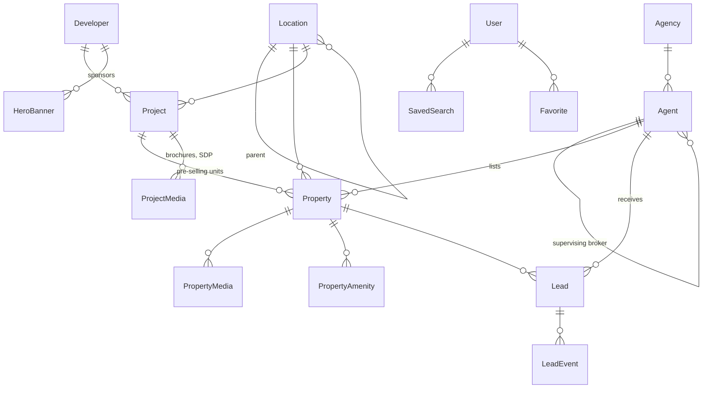

# Data model: Philippine real estate portal

Source of truth: `prisma/schema.prisma` (20 models). Database rules and PostGIS setup: `prisma/sql/postgis.sql`.



## Philippine conventions built in

| Area | How it is modelled |
| --- | --- |
| Currency | Pesos stored as `Decimal(15,2)`. Display via `src/lib/ph/format.ts`: ₱35,000/mo, ₱4.8M, ₱120M |
| Area | `floorAreaSqm` and `lotAreaSqm` (sqm). `pricePerSqm` is computed by a trigger, using lot area for Lot Only and Agricultural |
| Listing types | `SALE`, `RENT`, `PRE_SELLING`, `FORECLOSED` |
| Property types | Condominium, Townhouse, House and Lot, Lot Only, Commercial (with subtype), Agricultural, Warehouse |
| Locations | Region > Province > City/Municipality > Barangay, plus named districts (BGC, Makati CBD, Ortigas Center). `ancestorIds` lets one query cover "all of Taguig". `aliases` powers autocomplete ("BGC", "The Fort") |
| Pre-selling | Turnover quarter/year, reservation fee, downpayment % and term, spot-cash discount. Projects carry the DHSUD License to Sell number |
| Foreclosed | Foreclosing institution (Pag-IBIG Fund or bank), minimum bid, sale mode, auction date, occupancy, as-is-where-is |
| Ownership | Title type (TCT, CCT, OCT, tax declaration, contract to sell) and a foreign-ownership flag for condos |
| Agents | PRC licence for brokers; DHSUD accreditation plus a supervising broker for salespersons (RESA, RA 9646), with expiry dates and a verification status |
| Leads | Channels: Viber, WhatsApp, Send Inquiry, Request Sample Computation, call, callback, SMS. Sample-computation inputs are stored on the lead. Data Privacy Act consent timestamp, hashed IPs only |
| Banners | `HOME_HERO` scenery (unsponsored) and `DEVELOPER_SLIDER` slots, with schedule, location targeting, impressions and clicks |
| Financing | `FinancingProgram` holds Pag-IBIG and bank rates, caps and terms with a source URL, so the calculator never hard-codes rates |

## Rules enforced by the database

- Rent listings must have a rent period.
- Pre-selling listings must have a turnover year and a quarter from 1 to 4.
- Foreclosed listings must name the foreclosing institution.
- Area required by type: lot area for lots and agricultural land, both areas for house and lot, floor area otherwise.
- Brokers must have a PRC licence number; salespersons must have DHSUD accreditation and a supervising broker.

These are tested with `scripts/check-ph-data.mts` (formatting and seed) and against Postgres for the CHECK constraints.

## Left empty on purpose

- **Developers, projects and developer-slider banners**: add only with a signed partnership, since names and logos appear in promotions.
- **Financing programs**: enter current Pag-IBIG and bank figures from their published sources.
- **PSGC codes**: import from the PSA's official PSGC file rather than typing them.

## Setup

```bash
npx prisma migrate dev --name init   # creates tables
npm run db:postgis                    # PostGIS triggers, indexes and CHECK rules
npx prisma db seed                    # 65 locations, 21 amenities, 5 hero backgrounds
npm run check:ph                      # offline checks
```
